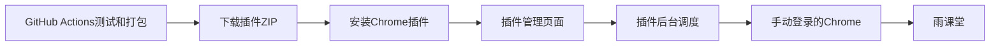
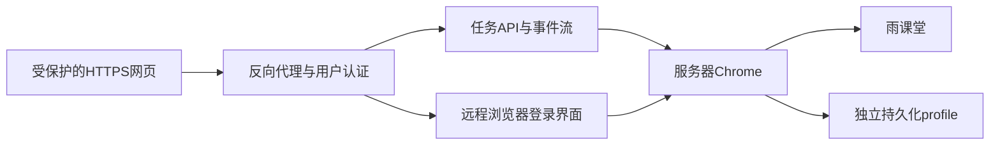

# 打包与服务器部署方案

推荐使用 Chrome 插件：GitHub Actions在Ubuntu中构建Manifest V3 ZIP，下载解压后加载到自己的Chrome，在同一配置中手动登录。插件内置管理页面与后台调度，不需要本地Node服务。原Windows独立程序保留为手动构建方式。

## 交付方式

| 方案 | 你怎么使用 | 播放发生在哪里 | 当前状态 | 适用场景 |
| --- | --- | --- | --- | --- |
| Chrome 插件（推荐） | 下载 ZIP，解压，加载扩展后打开学习台 | 自己电脑的 Chrome | 已实现插件和 Linux CI 打包，实际播放需安装后验证 | 单人使用，无额外服务 |
| 本地独立程序 | 手动构建 `.exe`，双击，打开本地网页 | 自己电脑的 Chrome | 保留构建脚本，不在当前 CI 发布 | 保留原 Node 工具运行方式 |
| 服务器应用 + 服务器浏览器 | 打开受保护的网站，在远程浏览器界面登录雨课堂 | 服务器运行的 Chrome | 需要增加服务器运行环境、登录界面与认证 | 自己电脑关闭后仍希望服务运行 |
| 服务器网页 + 本地代理 | 打开服务器网页，电脑仍运行配套代理 | 自己电脑的 Chrome | 需要增加配对和安全通信协议 | 希望统一网址、跨设备查看，但仍用本地浏览器 |

## 为什么不能只上传网页就直接使用

Node 版网页通过相对路径 `/api/*` 和 `/api/events` 请求本地 Node 服务。播放控制再由该服务访问本机Chrome调试端口，并复用Chrome的登录状态。插件版将这些调用替换为扩展消息，播放由 `chrome.debugger` 完成。这些扩展权限仅在已安装的 Chrome 插件中可用。

把它上传到Nginx或GitLab Pages，只能展示页面，不能访问用户电脑的已登录Chrome。服务器端的`127.0.0.1`指服务器自身，并不是用户电脑。个人电脑的雨课堂Cookie也不会自动出现在服务器浏览器里。

当前后台接口只接受本机Host和Origin，并绑定127.0.0.1。页面操作令牌用于防止其他网页操作本地工具，不是服务器用户登录认证。把监听改成`0.0.0.0`或公开Chrome的9222端口，不能替代完整服务器方案。

## 当前方案：Chrome 插件

已配置的流水线：

1. GitHub Actions的Ubuntu执行`npm ci`、语法检查、单元测试。
2. 第二个Ubuntu job使用相同Node.js版本执行插件构建。
3. 校验 Manifest、权限、后台和网页 JavaScript、所有网页资源、ZIP 内容和校验和。CI 不访问个人账号，也不播放课程视频。
4. artifacts仅收集插件 ZIP、哈希、构建元数据和安装说明，不上传旧 EXE、`.local`、浏览器profile或captures。

系统需要Chrome 118+，电脑需要保持运行。课程缓存和播放计划保存在插件本地存储，雨课堂登录由Chrome保存。关闭管理页面后活动 debugger 会话保持后台调度运行；点击“断开连接”停止队列。Chrome退出或系统睡眠后任务中断，重新打开时需主动连接、同步和开始。

GitHub托管的Ubuntu Runner可以完成测试和打包，无需自建Windows Runner。旧GitLab兼容配置保留使用 `node:24.22.2-bookworm-slim`。安装方法与权限说明见 [Chrome 插件说明](chrome-extension.md)。

## 方案二：服务器网页直接使用

若要求“电脑关机后仍运行”，推荐整套部署，而不是仅托管网页。

可以选Windows服务器配远程桌面，或Linux容器中的Chrome、Xvfb与noVNC。用户首次进入远程浏览器界面，亲自扫码或登录；Chrome在服务器保存其独立profile，Node服务连接该浏览器同机CDP。关闭远程登录窗口不影响服务进程，但登录失效或验证码仍需重新进入远程浏览器处理。

需要完成的代码与部署工作：

- 将当前Windows专用“打开登录浏览器”扩展为服务器预启动浏览器，添加受保护的远程浏览器入口。
- 为所有网页、读取接口、事件流和操作接口加入用户认证；配置一个明确的公共Origin，替换当前仅本机Host/Origin规则，保留来源校验。
- 持久化用户profile、课程缓存和任务计划；任务启动与重启恢复策略需要明确。当前重启只恢复选择，不自动启动任务。
- 将Chrome调试端口限制在同机或私有容器网络，外部只开放受认证的HTTPS入口。远程桌面也通过同一认证入口。
- 多用户时为每位用户隔离浏览器profile、任务、存储和访问权限，不能让多个用户共享当前全局`courses`和`queue`。
- Nginx为事件流关闭缓冲并设置足够读超时；服务进程用systemd或容器重启策略管理。
- 在服务器实际验证视频解码、倍速、后台播放、网络中断、并发和完整视频结束后的服务器确认。当前Windows本地的短时测试不能直接证明Linux服务器长期运行可靠。

试运行可从2核4GB、2段并发开始，再根据Chrome实际CPU、内存和带宽调整；这是容量规划起点，未做服务器压测。浏览器自身需要持续下载和解码，流量与同时播放数量一起增加。

当前没有部署上述服务器组件。完整服务器方案需要提供服务器类型、地址、域名、认证方式和单/多用户范围后才能配置并验收。

## 方案三：服务器网页与本地代理

此方式可以保留本地登录profile，但电脑仍需运行代理。推荐代理主动建立到服务器的HTTPS/WSS连接，通过短期配对码授权指定用户，服务器通过它获取状态和发送有限的任务操作。不要让服务器直接访问公开的Chrome调试端口。

它需要新的配对协议、任务权限、连接恢复、状态同步和版本兼容，不是简单给当前网页加一个CORS头。HTTPS网页直接请求HTTP localhost还涉及浏览器本地网络访问和混合内容限制，不能保证任意浏览器打开即用。

## 本次交付边界

本地8787服务保持停止。当前CI已改为Chrome插件打包，新增Manifest V3入口、Chrome调试适配、插件消息通信与存储，复用课程界面和并发队列。已生成本地插件ZIP并完成包校验和单元测试。

主仓库为 [ivanzqg/ykt-desk](https://github.com/ivanzqg/ykt-desk/tree/master)，代码提交至 `master`。实际执行情况以GitHub Actions页面为准。服务器部署当前是方案，没有开放外部端口或迁移登录信息。无需重新启动服务来阅读或下载程序。
